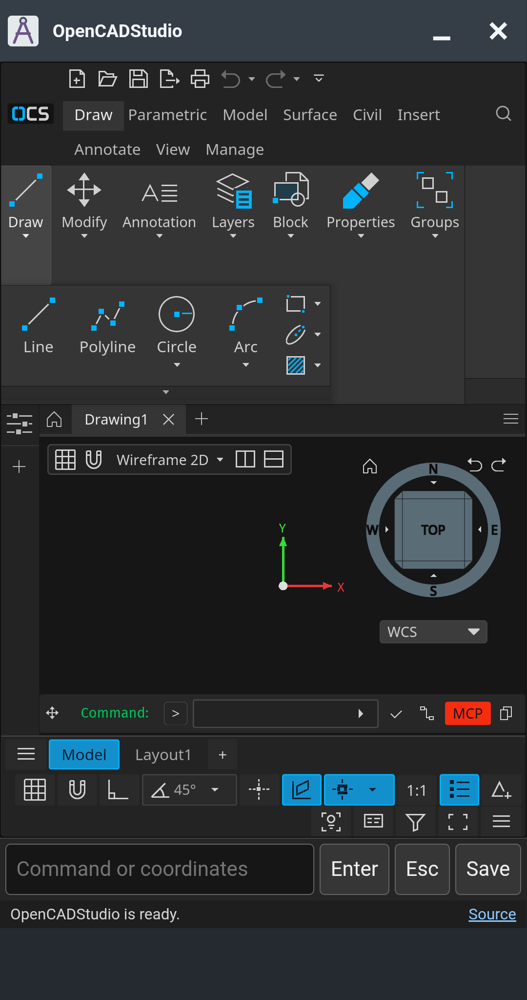
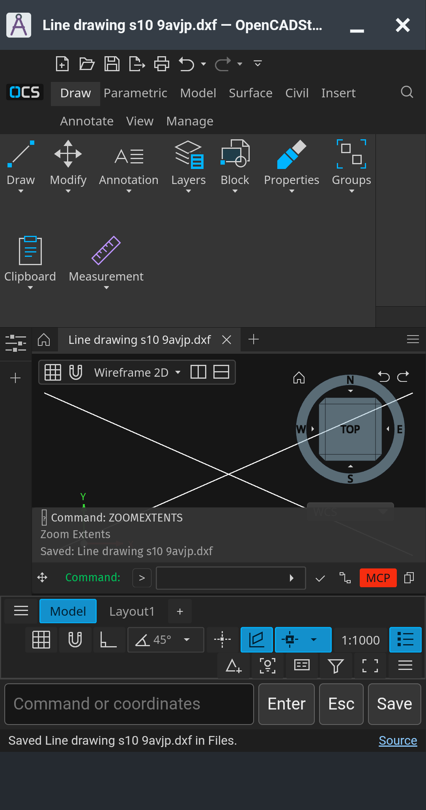

# OpenCADStudio in WebOS on a phone

Use Chrome on the Samsung Galaxy S10+ in portrait. The CAD menu opens OpenCADStudio. A signed-in account can reopen its drawings from server-backed My Files. Guests can use temporary My Files for the same drawing steps.

## Draw, save and reopen

1. Choose **New Drawing**, open the **Draw** ribbon, and tap **Line**.
2. Tap **Command or coordinates** and enter `#10,20` and `#60,42` separately. Tap **Esc**, then enter `ZOOMEXTENTS` to fit the line. The command field stays reachable with the Android keyboard open.
3. Tap **Save**, choose a folder, and enter a filename without a suffix. The editor adds `.dxf` for a new drawing.
4. Close the app and open **My Files**. Select that DXF and choose **Open With… → OpenCADStudio**. On the same drawing, make a second line from `#10,42` to `#60,20` and save to the original file. Both lines should be visible after fitting the view. A DWG opens directly in OpenCADStudio. The primary Files action for DXF opens CADCraft.

These steps cover the two phone workflows in the ten-workflow inventory: creating and fitting 2D geometry, and completing an editable DXF round trip. The [WebOS build and Files guide](../../web/WEBOS.md) describes supported formats and setup.

## Physical phone results

Galaxy S10+ Chrome `158.0.8127.92` passed both workflows in hosted guest mode and in a fresh signed-in session on the isolated viewer. Both saved coordinates and revisions were checked. The hosted viewport was 411 CSS pixels wide. The software keyboard kept the command form visible and the WebOS app menu returned after closing the editor. A new guest had separate temporary Files. Desktop Chromium `158.0.8127.36` repeated the editable workflow on ksu.codes. At 820 × 1050 CSS pixels, Chromium touch emulation reopened a drawing, reached Measurement and kept the app bar accessible.

## Desktop workflow inventory

| Workflow | Result in the isolated release |
| --- | --- |
| Create 2D geometry and fit the view | Passed. Both line coordinates matched the saved DXF. |
| DXF save, edit and reopen | Passed. Cancelled and retried Save, then reopened in a fresh sign-in and verified two revisions in Files. |
| DWG save, edit and reopen | Passed. Files opened DWG directly. Both saved revisions had an AC1032 header. |
| Open from the editor’s file picker | Passed. Reopened the annotated DXF through the native Open File action. |
| Organize geometry by layer | Passed. `QA_GEOMETRY` persisted in the DXF. |
| Add a measured dimension | Passed. The DXF retained the 50-unit linear dimension. |
| Create a paper layout | Passed. `QA_SHEET` persisted through reopening. |
| Export a plot | Passed. The Plot dialog downloaded a 9,379-byte PDF. |
| Model and inspect a 3D solid | Passed. Saved a box and reopened the drawing. The 3DSOLID handle matched its 5,271-byte DXF model-data record. |
| Resolve an external drawing reference | Open. Browser Xref Attach needs a WebOS Files reader. |

## Release verification

The isolated and hosted checks used viewer `5946993ae026a9e4f6de7bf82fe47dc5977373f63a927d2cf6606e98663c3074` and OpenCADStudio `860481708ca81e1631a712a04802f589b1ac2d46`. The source build used `trunk build --config WebOS.Trunk.toml --release --locked`. Copy the app runtime assets from `dist/webos` for packaging and exclude Trunk’s `.trunk-lock` build metadata.

The release verifier matched all 47 updated hosted paths and the integrity references for the editor and worker. The WebOS release record includes the rollback.
